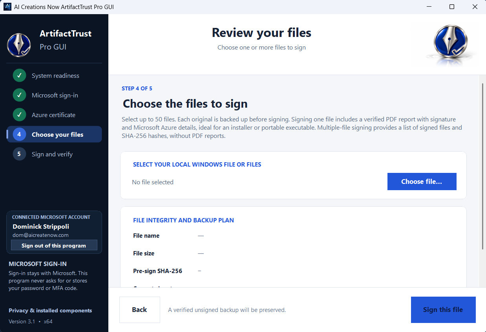
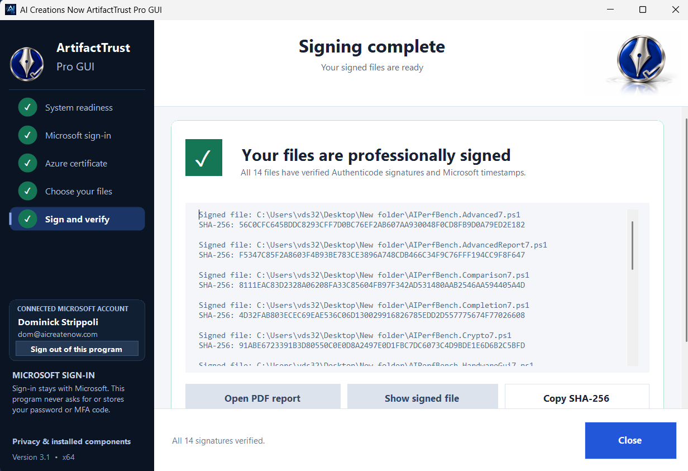

  

<h1 align="center">ArtifactTrust Pro GUI</h1>

<strong>Put your name on the software you create.</strong> 
A free Windows code-signing companion from AI Creations Now Software Development.

<strong>Version 3.1 · Windows x64 · Free for everyone</strong>

  <a href="https://download.aicreatenow.com/software/ArtifactTrustPro3.1.0microsoft.exe"><strong>Download Now</strong></a>
  &nbsp;·&nbsp; <a href="https://trustprogui.com/">Official Website</a>
  &nbsp;·&nbsp; <a href="https://trustprogui.com/screenshots.html">Screenshots</a>
  &nbsp;·&nbsp; <a href="https://buy.stripe.com/6oUeVf77ZdRCfMEbka5kk04">Buy Us a Coffee</a>

---

You made the software. Make its publisher easier to verify. **ArtifactTrust Pro GUI** brings Microsoft Artifact Signing into a guided desktop workflow for independent developers, home creators, and software teams.

Connect your existing Microsoft signing resources, choose your files, and review the results—all through a familiar Windows interface.

  

<a href="https://download.aicreatenow.com/media/aicreatenow/artifacttrust.mp4">Watch the demonstration</a> · <a href="https://trustprogui.com/features.html">Explore all features</a>

## One important file. Or your next release.

| | Single-file signing | Batch signing |
|---|---|---|
| **Files** | One compatible unsigned file | 2–50 compatible unsigned files |
| **Processing** | Sign and verify your selected file | Sign files sequentially using the same certificate profile |
| **Original backup** | Created and verified before signing | Created and verified for each file |
| **Verification** | Signature and timestamp checks | Signature and timestamp checks for each file |
| **PDF report** | Detailed three-page verification report | No PDF reports |

The single-file PDF records file details, hashes, publisher certificate, timestamp, and verification results. Open or print it with your Windows PDF viewer. It is a report about your software, not PDF document signing.

## From installation to signed

1. **Install and prepare.** Download the installer, then open the desktop shortcut. After you accept the first-use agreement, System Readiness prepares missing Microsoft components from the bundled packages.
2. **Connect your account.** Authenticate through Microsoft and select your existing subscription, signing account, and active Public Trust certificate profile.
3. **Choose and sign.** Select one file or a batch, check the selection, and start signing. Review the verification results and, for a single file, the PDF report.

  

## What you need

- **Windows:** Windows 10 version 1809 or later, or Windows 11, on a 64-bit x64 PC. Administrator access is required for installation and application operation.
- **Your Microsoft resources:** An eligible identity, Azure subscription, configured Microsoft Artifact Signing account, active **Public Trust** certificate profile, and signing permissions in the standard Azure public cloud.
- **Your files:** Compatible unsigned Windows software files, such as EXE, DLL, and MSI, **smaller than 4 GB each**, with sufficient space for original backups.
- **An internet connection:** Required for Microsoft authentication, resource discovery, signing, timestamping, and certificate checks.

**The application is free. Microsoft subscription and signing-service charges are separate.** Account setup, identity validation, and service eligibility are handled by Microsoft. The application does not create signing accounts or provide a certificate subscription.

[Read the setup guide and frequently asked questions →](https://trustprogui.com/help.html)

## Installation, sign-in, and privacy

Setup installs the application, documentation, and shortcuts. **Prerequisite preparation happens on the first application launch, after consent—not during Setup.** Required packages are bundled locally, and suitable installed components are reused.

The application keeps its own saved authorization for convenient repeat use. Microsoft controls session expiration and may require you to sign in again. **Sign Out** clears this application's saved local authorization. Uninstall removes the application and its product-owned authentication caches while leaving shared Microsoft prerequisites installed. It does not sign out unrelated Microsoft, browser, or Windows sessions.

[Privacy & Installation Agreement](https://trustprogui.com/privacy.html) · [Third-Party Notices](https://trustprogui.com/legal/THIRD-PARTY-NOTICES.txt) · [Terms & Donations](https://trustprogui.com/terms.html)

[Administrator deployment and silent-install switches →](GETTING-STARTED.md#silent-deployment)

## Free to use. Support is your choice.

No purchase or donation is required to download, install, or use ArtifactTrust Pro GUI. If the app makes your release day easier, an optional coffee helps support our independent software work.

**[Download the free Windows installer](https://download.aicreatenow.com/software/ArtifactTrustPro3.1.0microsoft.exe)** · **[Buy us a coffee](https://buy.stripe.com/6oUeVf77ZdRCfMEbka5kk04)**

**Microsoft Store:** [ArtifactTrust Pro GUI is available on Microsoft Store](https://apps.microsoft.com/detail/xp8lcmjczs31dn?hl=en-US&gl=US). The free direct Windows installer is also available above.

## Help and contact

[Getting Started](GETTING-STARTED.md) · [Support](SUPPORT.md) · [Setup & Help](https://trustprogui.com/help.html)

Contact [info@aicreatenow.com](mailto:info@aicreatenow.com) or **1-866-315-4750**. Visit [AI Creations Now Software Development](https://aicreatenow.com/) for our other applications.

Include your app version, Windows version, and error message. Remove passwords, tokens, authentication codes, and private information from shared screenshots or logs.

## About this repository

This repository contains product documentation and artwork for proprietary software; application source code is not included. GitHub’s **Code → Download ZIP** downloads these repository files. Use the Windows installer linked above to get the application. Free availability does not change the application’s ownership or the licenses of bundled components.

The official repository is [aicreatenowdom/artifacttrust-pro-gui](https://github.com/aicreatenowdom/artifacttrust-pro-gui), matching the current product name.

---

© 2026 **AI Creations Now Software Development**. All rights reserved.

ArtifactTrust Pro GUI is independent software, not sponsored, endorsed, or operated by Microsoft. Microsoft, Windows, and Azure are trademarks of the Microsoft group of companies. A digital signature helps identify a publisher and detect file changes; it does not certify that software is safe or guarantee acceptance by Windows, Microsoft Store, or antivirus vendors.
